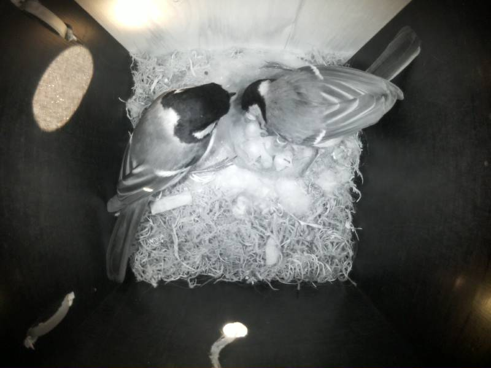

# Birdbox Website

Spring Boot website for our birdbox: a livestream from the camera inside, plus temperature and humidity sensor readings.

🔗 Live site: [https://birdbox.home.mabaka.ch/](https://birdbox.home.mabaka.ch/)

## Guests in spring 2026

A pair of Blue Tits (Blaumeisen) moved into the birdbox in spring 2026 and successfully raised 5 baby birds.

## Prerequisites

- Java 25
- Maven (the Maven wrapper `./mvnw` is included)
- A MariaDB database. `./start-mariadb.sh` starts a local container that matches the defaults in `src/main/resources/application.properties`.

## Build and run

    ./start-mariadb.sh
    ./mvnw clean verify
    ./mvnw spring-boot:run

The stream, status and sensor URLs are set in `src/main/resources/application.properties`.

## Docker image

Every release publishes a Docker image to the GitHub Container Registry:

    docker pull ghcr.io/mabakach/birdbox-website:latest

Use a version tag such as `1.0.19` to pin a release. The image is built for `linux/arm64` only.

Spring Boot reads its configuration from `/config/application.properties` inside the container. Mount your own file there:

    docker run -p 8080:8080 \
      -v ./application.properties:/config/application.properties \
      ghcr.io/mabakach/birdbox-website:latest

Each [GitHub release](https://github.com/mabakach/birdbox-website/releases) also has the image as a tar file. Load it with `docker load -i birdbox-website-<version>.tar`.

## CI/CD

- `.github/workflows/ci.yml` builds and tests every pull request and every push to `main`. It starts a MariaDB service container for the tests.
- `.github/workflows/release.yml` runs when a release tag such as `1.0.19` is pushed. It builds the image with Jib, pushes it to GHCR and creates a GitHub release with the image tar attached.

## Release

Run `mvn release:prepare` on `main`. It sets the release version, creates and pushes the tag, and moves the project to the next snapshot version. The release workflow does the rest. `release.sh` is the manual variant of the same process.

## License

See [LICENSE.md](LICENSE.md).
